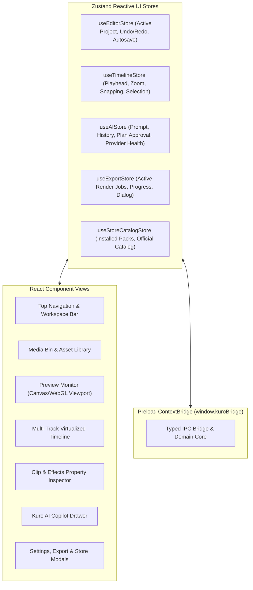

# KuroStudio Application UI Roadmap (Electron + React + Vite)

> **Specification & Phased Execution Plan for KuroStudio's Desktop UI Layer.**  
> Built with **React 18 / 19**, **TypeScript**, **Vite**, **Tailwind CSS**, and **Zustand**, running inside a hardened **Electron** desktop shell.

---

## 🎨 Design Philosophy & Aesthetic

- **Theme:** High-contrast Dark Studio workstation aesthetic (Deep obsidian `#0F172A`, slate panels `#1E293B`, vibrant cyber-blue accent `#38BDF8`, and neon purple AI branding `#A855F7`).
- **Typography:** Inter / JetBrains Mono (for timecodes, ticks, and debug diagnostics).
- **Responsiveness & Docking:** Flex/Grid layout with resizable splitters, collapsible panels, and persistent workspace state.
- **Precision:** Frame-accurate playhead scrub, integer tick snapping, and instant visual feedback.

---

## 🖥️ UI Architecture & State Flow

---

## 📋 Phased UI Implementation Roadmap

### 🧱 Phase UI-1: Foundations, Layout Shell & Workspace Splitter
- [x] **UI-1.1:** Setup React + Vite build inside `apps/desktop/src/renderer` & `apps/desktop/vite.config.ts`.
- [x] **UI-1.2:** Configure Tailwind CSS, design tokens, and Studio Dark theme palette (`global.css`).
- [x] **UI-1.3:** Implement resizable multi-pane Workspace Layout (`AppLayout.tsx` between Media Bin, Preview, Inspector, and Timeline).
- [x] **UI-1.4:** Implement **Top Navigation Bar** (`TopBar.tsx`):
  - Project Title & dirty indicator (`*` for unsaved changes).
  - New, Open, Save, Save As buttons.
  - Global Undo (`Ctrl+Z`) and Redo (`Ctrl+Y`) buttons with tooltip action descriptions.
  - Export modal trigger button.
  - AI Assistant toggle button with status badge.

---

### 🎬 Phase UI-2: Preview Monitor & Playback Controls
- [x] **UI-2.1:** **Canvas/HTML5 Viewport (`PreviewMonitor.tsx`):**
  - Responsive letterboxed viewport with 16:9 aspect ratio locking.
  - Safe title/action guide overlays toggle.
  - Fullscreen toggle (`F11`).
- [x] **UI-2.2:** **Playback Transport Bar:**
  - Play/Pause toggle button (`Space`).
  - Step One Frame Backward (`Left Arrow`) / Forward (`Right Arrow`).
  - Jump to Start (`Home`) / Jump to End (`End`).
  - Live SMPTE timecode readout (`HH:MM:SS:FF`) and frame counter.
  - Preview resolution dropdown (Full, 1/2, 1/4 quality proxy mode).

---

### 🎞️ Phase UI-3: Multi-Track Timeline Editor
- [x] **UI-3.1:** **Timeline Header & Time Ruler (`TimelineView.tsx`):**
  - Adaptive time ruler markers (seconds, frames, ticks).
  - Draggable playhead needle with smooth scrubbing.
  - Snapping toggle (`S` key: snap to clip edges, playhead, and markers).
  - Timeline zoom slider (`Ctrl + MouseWheel` support).
- [x] **UI-3.2:** **Track Headers:**
  - Video Track lanes (V1, V2, Overlay).
  - Audio Track lanes (A1, A2).
  - Track controls: Mute (`M`), Solo (`S`), Lock (`L`), Hide track.
  - Add Track / Delete Track buttons.
- [x] **UI-3.3:** **Timeline Clip Blocks:**
  - Visual clip rectangles positioned by integer ticks.
  - Clip title, duration tag, and thumbnail strip preview.
  - Dynamic audio waveform rendering overlay for audio/video clips.
  - Selected state highlighting (cyan glow).
  - Start edge & End edge hover trim handles (`[`, `]`).
  - Drag-and-drop clip repositioning across tracks with collision prevention indicator.
  - Split at Playhead tool (`Ctrl+K` / Razor tool).

---

### 📁 Phase UI-4: Media Bin & Asset Management
- [x] **UI-4.1:** Drag-and-drop file drop zone for videos, audio, and images (`MediaBin.tsx`).
- [x] **UI-4.2:** Native OS file picker button (`Import Media`).
- [x] **UI-4.3:** Asset Card component:
  - Thumbnail preview with hover scrub preview.
  - File name, duration badge, resolution, and codec pill.
  - Status indicator (Probing, Ready, Missing relink alert).
- [x] **UI-4.4:** Search filter bar and asset category tabs (All, Video, Audio, Images, Remotion).
- [x] **UI-4.5:** Draggable asset source: Drag from Media Bin directly onto Timeline tracks.

---

### 🎛️ Phase UI-5: Inspector & Properties Panel
- [x] **UI-5.1:** Selected Clip Overview (`InspectorPanel.tsx`: Asset source name, start tick, duration, speed).
- [x] **UI-5.2:** **Visual Transform Section:**
  - Position X/Y numerical steppers.
  - Scale X/Y slider (uniform scale toggle).
  - Rotation dial / angle input.
  - Opacity slider (0% to 100%).
- [x] **UI-5.3:** **Audio Properties Section:**
  - Volume fader slider (0% to 200%, with dB display).
  - Fade In & Fade Out duration steppers.
  - Pan slider (L100% to R100%).
- [x] **UI-5.4:** **Effects Stack Section:**
  - List of active clip effects with toggle switches.
  - Parameter controls (Brightness, Contrast, Saturation sliders).
  - Add Effect dropdown menu.
  - Remove effect button.
- [x] **UI-5.5:** **Transitions Section:**
  - Transition type selector (Cross-dissolve, Fade-to-black, Hard cut).
  - Duration picker.

---

### 🤖 Phase UI-6: Kuro AI Copilot Drawer
- [x] **UI-6.1:** Collapsible side drawer (`AIAssistantDrawer.tsx`) with quick toggle (`Ctrl+Space`).
- [x] **UI-6.2:** Chat stream view displaying user messages, agent plans, and action summaries.
- [x] **UI-6.3:** Prompt input bar with:
  - English & Arabic prompt recognition.
  - Suggested quick prompt pills ("Split selected clip here", "Lower music volume to 20%", "Add modern title intro").
- [x] **UI-6.4:** **Review Mode Approval Card:**
  - Structured list of proposed operations with color-coded risk tags (`Low`, `Medium`, `High`).
  - Affected clip names and timestamps.
  - "Approve & Execute" button vs "Cancel" button.
- [x] **UI-6.5:** **Direct Mode Action Feed:**
  - Real-time tool execution logs with checkmarks and one-click "Undo" button.
- [x] **UI-6.6:** Active model indicator & fallback badge (e.g. `Claude 3.5 Sonnet` / `GPT-4o` / `Ollama Local`).

---

### ⚙️ Phase UI-7: Modals (Settings, Export & Store)
- [x] **UI-7.1:** **AI Provider Settings Modal (`SettingsModal.tsx`):**
  - Tabbed provider configuration (OpenAI, Gemini, Claude, Ollama, Custom API).
  - Obfuscated API key inputs with secure storage indicator.
  - "Test Connection" button with live latency / status badge.
  - Cloud / Local privacy fallback toggle switch.
- [x] **UI-7.2:** **Export Render Queue Modal (`ExportModal.tsx`):**
  - Preset selector (1080p 60fps, 1080p 30fps, 720p 30fps).
  - Bitrate slider, audio format toggle.
  - Output file destination picker.
  - Live export progress modal: Progress bar (0–100%), elapsed time, ETA, Cancel button, and "Reveal File in Explorer" on finish.
- [x] **UI-7.3:** **Official Store Modal (`StoreModal.tsx`):**
  - Catalog grid of official KuroLabs packs (LUTs, Transitions, Title Packs).
  - Pack details modal: preview video/image, license, declared assets.
  - Install / Uninstall button with progress ring.

---

### 🧪 Phase UI-8: Polish, Keyboard Shortcuts & Diagnostics
- [ ] **UI-8.1:** Keyboard shortcut manager (`Space`, `Ctrl+Z`, `Ctrl+Y`, `Ctrl+K`, `Delete`, `Ctrl+S`, `F11`).
- [ ] **UI-8.2:** Missing media relink dialog modal.
- [ ] **UI-8.3:** Privacy-preserving diagnostic bundle preview & report modal.
